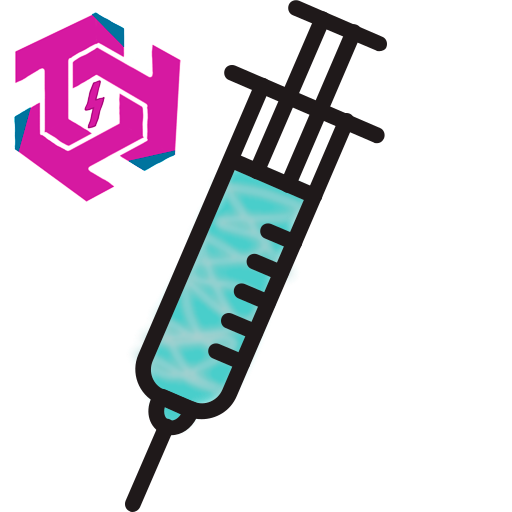

<p align="center">
  
</p>

<h1 align="center">TechTeaStudio.Injector</h1>

<p align="center">
  Lightweight, expression-tree-compiled dependency injection container for .NET 8 / 9 / 10. Open generics, decorators, lifecycle hooks, async disposal, child scopes, Lazy / Func / Owned, plus a Microsoft.Extensions.DependencyInjection sidecar for ASP.NET Core, Generic Host, and EF Core integration.
</p>

<p align="center">
  <a href="https://www.nuget.org/packages/TechTeaStudio.Injector"></a>
  <a href="https://www.nuget.org/packages/TechTeaStudio.Injector"></a>
  <a href="https://www.nuget.org/packages/TechTeaStudio.Injector.Extensions.DependencyInjection"></a>
  
  <a href="https://github.com/TechTeaStudio/Injector/actions/workflows/dotnet.yml"></a>
  <a href="LICENSE.txt"></a>
</p>

## Overview

`TechTeaStudio.Injector` is a from-scratch dependency injection container for .NET. It compiles per-registration activators as expression-tree lambdas, caches them, and resolves with a single virtual call plus a delegate invoke. The public surface is small and the implementation has no transitive dependency on `Microsoft.Extensions.DependencyInjection`, so it drops into class libraries, CLI tools, desktop apps, plugins, and games without dragging the hosting stack along with it.

For ASP.NET Core, Generic Host, and EF Core the sister package `TechTeaStudio.Injector.Extensions.DependencyInjection` adapts the container to `IServiceProvider`, `IServiceScopeFactory`, `IServiceProviderFactory<IContainerBuilder>`, `IServiceProviderIsService`, `IServiceProviderIsKeyedService`, and `IKeyedServiceProvider`. The same library backs both worlds.

## When to reach for it

You want this library when you need a real DI container with Autofac's feature set but Microsoft.Extensions.DependencyInjection's footprint. Concretely:

- A class library, plugin, CLI, or desktop / game app where pulling `Microsoft.Extensions.*` into a leaf module is overkill.
- A web API where you want decorators, lifecycle hooks, child scopes with extra registrations, and `Owned<T>` ownership transfer without bolting Scrutor and Autofac onto MEDI.
- A codebase that values an explicit `[Inject]` opt-in for property and method injection over conventions.
- An ASP.NET Core / Generic Host service where you'd swap MEDI's container under the hood and keep the rest of your code unchanged. The sidecar handles that.

You probably **don't** want this library when you need NativeAOT today (the v1.0 roadmap covers it via a source generator, not shipped yet), when MEDI's exact feature set already covers everything you do and you don't want decorators / hooks / `Owned`, or when your team is already invested in Autofac and switching containers is not worth the migration cost.

## How it compares

| Capability | Injector | Autofac | MEDI |
|---|---|---|---|
| Constructor injection | yes | yes | yes |
| Property / method injection | yes (`[Inject]`) | yes (`PropertiesAutowired`) | no |
| Decorators (built-in) | yes (compiled) | yes | no (Scrutor needed) |
| Modules / assembly scan | yes | yes | no (Scrutor needed) |
| Open generics | yes | yes | yes |
| `Lazy<T>` / `Func<T>` / `Func<P, T>` | yes (auto) | yes | no |
| `Owned<T>` ownership transfer | yes | yes | no |
| Lifecycle hooks (`OnActivating` / `OnActivated`) | yes | yes | no |
| Child scopes with extra registrations | yes | yes | no |
| `IEnumerable<T>` / `IReadOnlyDictionary<TKey,T>` | yes | yes | partial (`IEnumerable<T>` only) |
| Validate-on-build | yes (opt-in) | partial | yes |
| `IAsyncDisposable` | yes | yes | yes |
| Circular detection with full chain | yes | partial | partial |
| ASP.NET Core / Hosting integration | via sidecar | via `Autofac.Extensions.DependencyInjection` | native |
| Keyed services (.NET 8 `[FromKeyedServices]`) | yes (via sidecar) | yes | yes |
| NativeAOT | v1.0 roadmap | partial | yes |

The honest pitch: Injector sits between **"MEDI plus Scrutor"** and **"a full Autofac setup"**. If you've ever installed Scrutor for decorators, then realised you also wanted lifecycle hooks and `Owned<T>`, this is the package that already covers both without the Autofac surface area.

## Install

Core container:

```bash
dotnet add package TechTeaStudio.Injector
```

For ASP.NET Core / Generic Host / EF Core integration, add the sidecar:

```bash
dotnet add package TechTeaStudio.Injector.Extensions.DependencyInjection
```

Or pin specific versions in `.csproj`:

```xml
<PackageReference Include="TechTeaStudio.Injector" Version="0.2.0" />
<PackageReference Include="TechTeaStudio.Injector.Extensions.DependencyInjection" Version="0.3.0" />
```

## Quick start (core)

```csharp
using TechTeaStudio.Injector;

var builder = new ContainerBuilder();

builder.Register<ILogger, ConsoleLogger>().AsSingleton();
builder.Register<IGreeter, Greeter>().AsTransient();
builder.RegisterDecorator<IGreeter, TimingGreeterDecorator>();

// Open generics:
builder.Register(typeof(IRepository<>), typeof(Repository<>)).AsScoped();

// Lifecycle hooks:
builder.Register<IDbInit, DbInit>()
       .AsSingleton()
       .OnActivated(_ => Console.WriteLine("DbInit constructed"));

await using IContainer container = builder.Build(new BuildOptions { ValidateOnBuild = true });

var greeter = container.Resolve<IGreeter>();
greeter.Greet("World");

await using (IScope scope = container.CreateScope())
{
    var repo = scope.Resolve<IRepository<User>>();   // closed-on-demand
    var lazy = scope.Resolve<Lazy<IGreeter>>();      // auto-wrapped

    using (Owned<IReportBuilder> owned = scope.Resolve<Owned<IReportBuilder>>())
    {
        owned.Value.Build();
    } // releases the owned graph
}
```

## Quick start (ASP.NET Core / Generic Host)

```csharp
using Microsoft.Extensions.Hosting;
using TechTeaStudio.Injector;
using TechTeaStudio.Injector.Extensions.DependencyInjection;

var host = Host.CreateApplicationBuilder(args);

// Standard IServiceCollection registrations still work:
host.Services.AddSingleton<ILogger, ConsoleLogger>();

// Swap the host's container with Injector and add Injector-only registrations on top:
host.ConfigureContainer(
    new InjectorServiceProviderFactory(new BuildOptions { ValidateOnBuild = true }),
    builder =>
    {
        builder.Register(typeof(IRepository<>), typeof(Repository<>)).AsScoped();
        builder.RegisterDecorator<IGreeter, TimingGreeterDecorator>();
    });

using var app = host.Build();
// ASP.NET Core, EF Core, and Hosting now resolve every service through TechTeaStudio.Injector.
```

## Lifetimes at a glance

| Lifetime | Per-resolution behaviour | When to use |
|---|---|---|
| `AsTransient()` | New instance every call. | Default for cheap, stateless services. |
| `AsScoped()` | Same instance within a single `IScope`. | Per-request / per-operation state. |
| `AsSingleton()` | Single instance for the whole container's lifetime. | Caches, configuration, expensive shared deps. |

## Feature notes

### Open generics

Register an open generic implementation against an open generic service. The container synthesizes the closed registration on demand and caches it.

```csharp
builder.Register(typeof(IRepository<>), typeof(Repository<>)).AsScoped();

var users  = scope.Resolve<IRepository<User>>();
var orders = scope.Resolve<IRepository<Order>>();
// Two distinct closed registrations, two distinct scoped instances per scope.
```

Closed-generic registrations take precedence when both are present.

### `Lazy<T>` / `Func<T>` / `Func<P, T>` auto-resolution

```csharp
builder.Register<IFoo, Foo>().AsTransient();

var lazy   = container.Resolve<Lazy<IFoo>>();           // deferred resolution
var factory = container.Resolve<Func<IFoo>>();           // delegate
var paramFactory = container.Resolve<Func<string, IFoo>>(); // ctor takes a string + resolved deps
```

No explicit registration is needed for any of these.

### `Owned<T>` ownership transfer

```csharp
using (Owned<IReportBuilder> owned = container.Resolve<Owned<IReportBuilder>>())
{
    owned.Value.Build();
} // disposing the Owned<T> disposes the inner scope and everything it pulled in
```

The inner scope is parented at the active resolver, independent of the caller's scope lifetime.

### Lifecycle hooks (`OnActivating` / `OnActivated`)

```csharp
builder.Register<IFoo, Foo>()
       .OnActivating(f => f.Configure())     // before property / method injection
       .OnActivated (f => f.Initialize());   // after property / method injection
```

Hooks fire once per activation: once total for singletons, on every resolve for transients.

### Child scopes with extra registrations

```csharp
using var scope = container.CreateScope();

using (var child = scope.BeginLifetimeScope(b => b.RegisterInstance(currentRequest)))
{
    var handler = child.Resolve<IRequestHandler>(); // sees currentRequest + every parent registration
}
```

Disposing the child disposes only what the child created. The parent keeps running.

### Validate-on-build

```csharp
var container = builder.Build(new BuildOptions { ValidateOnBuild = true });
// AggregateException at Build() if any registration has a missing or cyclic dependency
```

The validator walks every non-open-generic registration in a throwaway scope and aggregates failures.

### Decorators with compiled activators

```csharp
builder.Register<IGreeter, Greeter>().AsTransient();
builder.RegisterDecorator<IGreeter, TimingGreeterDecorator>();
builder.RegisterDecorator<IGreeter, LoggingGreeterDecorator>();

var g = container.Resolve<IGreeter>();
// g is new LoggingGreeterDecorator(new TimingGreeterDecorator(new Greeter()))
```

Each decorator activator is built as an `Expression.Lambda<Func<IResolver, object, object>>`, compiled once, cached per registration. Build-time validation rejects a decorator without a matching base registration.

### Modules and assembly scanning

```csharp
public sealed class LoggingModule : IModule
{
    public void Register(IContainerBuilder b) =>
        b.Register<ILogger, ConsoleLogger>().AsSingleton();
}

builder.RegisterModule(new LoggingModule());
builder.RegisterAssembly(typeof(Program).Assembly, t => t.Name.EndsWith("Handler"));
```

`RegisterAssembly` walks every concrete public class matching the predicate and binds it to itself plus every interface it implements (skipping `IDisposable` and `IAsyncDisposable`).

### Property and method injection

```csharp
public sealed class Worker
{
    [Inject] public ILogger? Logger { get; set; }

    [Inject]
    public void Initialise(IService service) { /* ... */ }
}
```

The injection passes run after construction (property first, then method). Without the attribute, neither runs; explicit opt-in keeps reflection cost minimal.

### Collection resolution

```csharp
var all = scope.ResolveAll<IHandler>();                  // every registration of IHandler
var byKey = scope.ResolveDictionary<string, IHandler>(); // only the WithKey(...) ones
```

Injectable as constructor parameters too: `IEnumerable<IHandler>`, `IReadOnlyList<IHandler>`, `IReadOnlyDictionary<string, IHandler>`.

## Public API (selected)

```csharp
namespace TechTeaStudio.Injector;

public interface IContainerBuilder
{
    IRegistrationBuilder Register<TService, TImpl>() where TImpl : class, TService where TService : class;
    IRegistrationBuilder Register<TService>() where TService : class;
    IRegistrationBuilder Register<TService>(Func<IResolver, TService> factory) where TService : class;
    IRegistrationBuilder Register(Type serviceType, Type implementationType);
    IRegistrationBuilder Register(Type serviceType);
    IRegistrationBuilder RegisterInstance<TService>(TService instance) where TService : class;
    IContainerBuilder    RegisterDecorator<TService, TDecorator>() where TDecorator : class, TService where TService : class;
    IContainerBuilder    RegisterModule(IModule module);
    IContainerBuilder    RegisterAssembly(Assembly asm, Predicate<Type>? filter = null, Lifetime lifetime = Lifetime.Transient);
    IContainer           Build();
    IContainer           Build(BuildOptions options);
}

public interface IRegistrationBuilder
{
    IRegistrationBuilder AsTransient();
    IRegistrationBuilder AsScoped();
    IRegistrationBuilder AsSingleton();
    IRegistrationBuilder WithKey(object key);
    IRegistrationBuilder As(params Type[] additionalServiceTypes);
    IRegistrationBuilder OnActivating(Action<object> hook);
    IRegistrationBuilder OnActivated (Action<object> hook);
}

public interface IResolver
{
    T                          Resolve<T>();
    object                     Resolve(Type serviceType);
    IEnumerable<T>             ResolveAll<T>();
    IEnumerable<object>        ResolveAll(Type serviceType);
    IDictionary<TKey, T>       ResolveDictionary<TKey, T>() where TKey : notnull;
}

public interface IContainer : IResolver, IDisposable, IAsyncDisposable
{
    IScope CreateScope();
}

public interface IScope : IResolver, IDisposable, IAsyncDisposable
{
    IScope BeginLifetimeScope(Action<IContainerBuilder> configure);
}
```

For the MEDI sidecar:

```csharp
namespace TechTeaStudio.Injector.Extensions.DependencyInjection;

public sealed class InjectorServiceProvider :
    IServiceProvider, IServiceProviderIsService, IServiceProviderIsKeyedService,
    IKeyedServiceProvider, IDisposable, IAsyncDisposable { /* ... */ }

public sealed class InjectorServiceProviderFactory : IServiceProviderFactory<IContainerBuilder>
{
    public InjectorServiceProviderFactory();
    public InjectorServiceProviderFactory(BuildOptions? buildOptions);
    public IContainerBuilder CreateBuilder(IServiceCollection services);
    public IServiceProvider CreateServiceProvider(IContainerBuilder builder);
}

public static class ServiceCollectionExtensions
{
    public static IContainerBuilder PopulateFromServiceCollection(this IContainerBuilder b, IServiceCollection s);
    public static IServiceProvider  AsServiceProvider(this IContainer container);
}
```

## Project layout

```
Injector/
├── src/TechTeaStudio.Injector/                                <- core NuGet package
│   ├── ContainerBuilder.cs, Container.cs, Scope.cs            <- registration + resolution + scoping
│   ├── Activators.cs, Registration.cs                         <- expression-tree compilation
│   ├── BuildOptions.cs, Owned.cs, DisposalHelpers.cs          <- v0.2 additions
│   ├── ChildScopeRegistry.cs                                  <- child-scope-extra registrations
│   ├── IContainerBuilder.cs, IResolver.cs, IContainer.cs,
│   │   IScope.cs, IModule.cs, Lifetime.cs, InjectAttribute.cs,
│   │   Exceptions.cs                                          <- public surface
│   └── AssemblyInfo.cs                                        <- InternalsVisibleTo sidecar
├── src/TechTeaStudio.Injector.Extensions.DependencyInjection/ <- MEDI sidecar package
│   ├── InjectorServiceProvider.cs
│   ├── InjectorServiceScope.cs, InjectorServiceScopeFactory.cs
│   ├── InjectorServiceProviderFactory.cs
│   ├── ServiceCollectionExtensions.cs
│   └── KeyedResolutionHelpers.cs
├── samples/TechTeaStudio.Injector.Sample/                     <- console demo (not packaged)
├── tests/TechTeaStudio.Injector.Tests/                        <- 82 xUnit tests
├── tests/TechTeaStudio.Injector.Extensions.DependencyInjection.Tests/ <- 45 sidecar tests
├── .github/workflows/dotnet.yml                               <- shared TTS NuGet publish workflow
├── CHANGELOG.md
├── LICENSE.txt
└── README.md
```

## Build &amp; test

```bash
dotnet build Injector.slnx
dotnet test  Injector.slnx
```

Requires .NET SDK 10. The core library and the sidecar both multi-target `net8.0;net9.0;net10.0`. The sample and the test projects are `net10.0` only. 127 tests pass across the two test projects (82 core + 45 sidecar) with 0 warnings on Release.

## Versioning &amp; release

Two `<Version>` declarations live in the respective `.csproj` files: `src/TechTeaStudio.Injector/TechTeaStudio.Injector.csproj` for the core, `src/TechTeaStudio.Injector.Extensions.DependencyInjection/TechTeaStudio.Injector.Extensions.DependencyInjection.csproj` for the sidecar. Both follow 3-part SemVer (`X.Y.Z`). Bump rules:

- Bug fix: `Z + 1`
- New feature, source-compatible: `Y + 1`, reset `Z = 0`
- Breaking change after `1.0`: `X + 1`, reset `Y = Z = 0`

Commit format is `vX.Y.Z <short description>`. Push to `product` triggers the shared TechTeaStudio NuGet publish workflow at `.github/workflows/dotnet.yml`, which packs every project matched by `src/*/*.csproj` and pushes to nuget.org with `--skip-duplicate`. Never push to nuget.org manually.

See [CHANGELOG.md](CHANGELOG.md) for the full release history.

## Further reading

- [QUICKSTART.md](QUICKSTART.md): one-page reference of every public surface with copy-pasteable snippets.
- [CHANGELOG.md](CHANGELOG.md): release notes for every published version.
- [ARCHITECT_REVIEW.md](ARCHITECT_REVIEW.md): internal architectural review of v0.2.0 + v0.3.0.

## License

Licensed under the [MIT License](LICENSE.txt). Copyright &copy; Tech Tea Studio.

<p align="center">
  Built as part of the Hyperion Ecosystem by <a href="https://techteastudio.cc">TechTeaStudio</a>.
</p>
